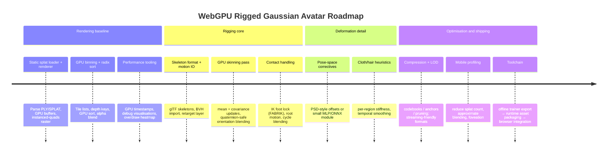

# 3D Gaussian Splat Animation with Skeleton and Muscle Rigging for WebGPU

## Executive summary

3D Gaussian Splatting (3DGS) represents a scene (or character) as millions of anisotropic volumetric "splats" (3D Gaussians) with optimised position, opacity, covariance (shape/orientation), and view-dependent appearance (commonly spherical harmonics). It renders by projecting each 3D Gaussian into a 2D ellipse and compositing via depth-sorted alpha blending in a tile-based rasterisation pipeline, achieving real‑time rates on desktop GPUs in native implementations. citeturn31view3turn31view1turn25view0

For character animation, the centre of gravity in the literature has shifted from "reconstruct a moving subject frame-by-frame" to "learn a canonical (rest) Gaussian avatar + a deformation model that can be driven by a pose/skeleton", because a canonical representation can be re‑posed (walk cycles, retargeted motion, IK edits) and then rendered in real time. This pattern appears in multiple high-impact systems:
- **Pose-driven canonical Gaussians + learned per-splat skinning weights (LBS)** (e.g., HUGS) to avoid holes/pop-outs during articulation and to enable novel-pose synthesis at interactive rates. citeturn16view3turn23view1turn23view0
- **Canonical Gaussians + non-rigid deformation field + LBS ("neural skinning")** (e.g., 3DGS-Avatar), designed specifically for new poses such as walk cycles. citeturn22search6turn23view3
- **Gaussians-on-Mesh hybrids** (e.g., GoMAvatar) that bind splats to an explicit deformable mesh scaffold, gaining compatibility with conventional rigging pipelines and compact memory footprints. citeturn22search3turn23view4turn4search2
- **Automatic skeleton extraction + Gaussian binding** for general articulated objects (RigGS), pointing toward template-free rigging of splats. citeturn23view6turn7view0turn11view1

On the WebGPU side, real-time *rendering* of Gaussian splats in the browser is already practical and open-source: multiple WebGPU renderers implement GPU-side sorting and tile-based compositing, sometimes exceeding 200 FPS on high-end desktop GPUs, and are licensed permissively (Apache-2.0/MIT). citeturn17view2turn3view2turn3view0turn0search39turn17view0turn3view3
However, *training* these neural/deformable models remains overwhelmingly CUDA/PyTorch centric in most official releases (often with non-commercial licences), so a realistic WebGPU strategy is "offline training → export (possibly compressed) → WebGPU runtime for animation + rendering." citeturn14view0turn15view3turn5view0turn6view0

The key engineering bottlenecks for WebGPU character animation are: (1) **deform Gaussians correctly under bone transforms** (means and covariances), (2) **handle the non-linear rotation parts during blending** (LBS artefacts can be worse for Gaussian orientation than for mesh vertices), and (3) **sort/composite efficiently under browser constraints** (bandwidth and overdraw). Recent work explicitly targets (2) with quaternion-averaging-style fixes for Gaussian skinning. citeturn18search2turn23view7

## Foundations of splatting, radiance fields, and point-based rendering

### Core algorithms in play

**3D Gaussian Splatting as a radiance-field-like primitive.** The 3DGS pipeline introduced anisotropic 3D Gaussians as an explicit yet differentiable scene representation. Each Gaussian is optimised in position, opacity, anisotropic covariance, and spherical harmonics (SH) coefficients for view-dependent colour; density control adds/removes Gaussians during optimisation, yielding models with roughly **1–5 million Gaussians** for the evaluated scenes. citeturn31view1
Rendering is done by projecting each 3D Gaussian into a 2D footprint and performing alpha blending with a visibility-aware, tile-based rasteriser that sorts splats by depth (per tile) and blends in order. citeturn31view3turn31view1

**Dynamic variants (4DGS and related).** A common dynamic extension is: maintain a canonical set of 3D Gaussians and apply a learned deformation field conditioned on time (or motion) to obtain per-frame Gaussians. 4D-GS describes an efficient "Gaussian deformation field" network and reports real-time rendering up to **82 FPS at 800×800 (synthetic)** and **30 FPS at 1352×1014 (real)**. citeturn16view2turn23view2

**NeRF-family baselines and why splats are attractive for animation.** NeRF represents a scene as a continuous 5D function (position + view direction) implemented by an MLP and rendered by volumetric ray marching, which is differentiable but computationally expensive. citeturn19search0
Instant-NGP accelerates NeRF-like models via multiresolution hash-grid encodings and fused CUDA kernels, enabling training in seconds and faster rendering than classic NeRF, but still relies on sampling and neural evaluation. citeturn19search1turn19search9
For animation, the practical appeal of splats is that *forward deformation* (canonical → posed) can be made direct and explicit, avoiding iterative root-finding/backward mapping that appears in many implicit deformation pipelines. HUGS explicitly calls out root-finding loops as a deformation pain-point for neural fields and positions splats as a more controllable alternative. citeturn16view3turn23view1

**Point-based rendering heritage.** The splat rasterisation ideas draw heavily from "surface splatting" and EWA (elliptical weighted average) filtering in point rendering, which focuses on projecting point kernels to screen space for high-quality reconstruction and texture filtering. citeturn18search3turn18search15
3DGS cites the projection of 3D covariance into image space inspired by prior splatting work and uses sorted alpha blending for compositing. citeturn31view3turn18search15

image_group{"layout":"carousel","aspect_ratio":"16:9","query":["3D Gaussian Splatting real-time radiance field rendering teaser image","Gaussian splatting ellipsoid projected to screen space ellipse diagram","HUGS Human Gaussian Splats CVPR figure","GoMAvatar Gaussians-on-Mesh CVPR figure"],"num_per_query":1}

### How splats represent geometry and appearance

A single 3D Gaussian can be thought of as a volumetric ellipsoid kernel in 3D space with:
- **Mean** (centre position) and **covariance** (anisotropic shape/orientation) for geometry coverage. 3DGS emphasises that optimising the *full* covariance (anisotropy) helps Gaussians align with surfaces and improves rendering quality at fixed point counts. citeturn31view0turn31view3
- **Opacity** (per-Gaussian alpha contribution) and **colour** (often SH-based view dependence). The 3DGS paper reports improved PSNR when including spherical harmonics to model view-dependent effects. citeturn31view0turn31view1

A core mathematical step is projecting a 3D covariance into camera/image space using the Jacobian of the projective transform (affine approximation) and then rasterising the resulting 2D ellipse. citeturn31view3
This is the step you must re-run every frame (or every pose update) for animated characters, because both the mean and the covariance change under deformation.

## Rigging and deformation strategies for animatable Gaussians

### Skeleton-driven splats: the canonical pattern

A high-level pattern that recurs across "riggable splats" papers is:

1) Learn or define a **canonical (rest) Gaussian set**.
2) Provide a **pose (skeleton)** per frame.
3) Apply forward deformation to obtain posed Gaussians.
4) Render posed Gaussians with standard splat rasterisation.

HUGS makes this explicit: it represents the human in a canonical space and predicts LBS weights to deform canonical Gaussians into the final pose, coordinating Gaussians to keep surface integrity (avoid holes/pop-outs). citeturn16view3turn23view1turn23view0
3DGS-Avatar similarly deforms a canonical Gaussian field (non-rigid module) and then uses LBS with learned neural skinning to transform into observation space. citeturn22search6turn23view3

### Linear blend skinning, dual quaternions, and why Gaussians make it harder

**Linear Blend Skinning (LBS).** LBS (matrix palette skinning) is the standard real-time method in games: each vertex is transformed by a weighted sum of bone transforms. It is widely implemented and GPU-friendly. citeturn20search8turn20search0
For splats, you can treat each Gaussian mean like a "vertex" and apply LBS directly to its centre. The complication is the **covariance/orientation/scale**, which must remain valid (positive definite) and visually coherent under blending.

**Dual Quaternion Skinning (DQS).** DQS was introduced to reduce LBS artefacts (e.g., candy-wrapper twisting) by blending rigid transforms as dual quaternions; it is still GPU-friendly, but more complex than LBS. citeturn20search1turn20search21
For splats, DQS (or DQS-like rotation blending) is attractive because many splat attributes are inherently rotational (the Gaussian's local frame), and simple matrix blending can produce invalid or visually wrong rotations.

**Gaussian-specific skinning issues.** A recent paper ("On the Skinning of Gaussian Avatars") argues that naïvely applying LBS to Gaussian rotation-related properties is invalid because those properties are non-linear under rotation blending; it proposes quaternion-averaging-style weighted rotation blending to address the artefacts while staying compatible with Gaussian rasterisers. citeturn18search2turn23view7
This is directly relevant if you plan to skin splats in a WebGPU engine: you should design your per-splat representation so that rotational updates are blended with an appropriate manifold-aware method (quaternions / dual quats), not just 3×3 matrix LBS.

### Mesh-guided rigging: Gaussians bound to explicit surfaces

A pragmatic way to get "proper" rigs (and leverage existing animation tools) is to attach Gaussians to a mesh scaffold:

- **Gaussians-on-Mesh (GoMAvatar).** GoMAvatar explicitly positions and renders Gaussians on a deformable mesh representation, emphasising both compatibility with rasterisation pipelines and compact storage (reported **3.63 MB per subject**) with real-time rendering (**43 FPS**). citeturn22search3turn23view4
- **GaussianAvatars (head rigging).** GaussianAvatars rigs Gaussians to a parametric morphable face model, parameterising splats by a local coordinate frame of a mesh triangle and optimising displacements for better geometry. citeturn4search3turn4search11turn8view1
  This is essentially "bind splats to the mesh's local frame + use the model's rig/expressions to drive animation," a very transferable idea for body rigs if you have a mesh proxy.

Mesh-guided approaches are especially compelling for WebGPU because you can reuse mature skeleton tooling (e.g., glTF rigs), and the mesh gives you a natural place to compute skinning weights and to resolve bone-space frames for rotating Gaussian orientation.

### Template-free "auto-rigging" for splats

RigGS targets articulated objects in videos and aims to automatically build a skeleton and binding without requiring a template prior; its visualisations explicitly include constructed skeletons and skinning weights, and it is positioned as editable/drivable/re-poseable. citeturn4search4turn23view6turn7view0
For character work, the immediate takeaway is less "use RigGS as-is in WebGPU" (it is a research training pipeline) and more "this is evidence that *automatic* Gaussian-to-skeleton binding is feasible," which informs roadmap decisions about manual vs learned weight assignment.

### Muscle simulation, blendshapes, and implicit deformation layers

Most Gaussian-avatar systems today primarily expose **skeleton-level control**, not full musculoskeletal simulation. When "muscle-like" effects are present, they are typically approximated by:
- **Pose-dependent corrective deformations** (e.g., learned offsets conditioned on joint angles/pose embedding), analogous in spirit to pose space deformation (PSD) used in classical rigs. citeturn21search2turn22search6
- **Blendshape-style expression layers** (especially in head avatars), where a parametric model provides expression controls. citeturn4search11turn21search11

If you truly want muscle simulation, classical literature models muscles/bones/skin as anatomical components and uses volumetric/elastic simulation to create bulging and secondary motion. citeturn21search4turn21search8turn21search20
In a Gaussian-splat runtime, the practical integration point is typically a **deformation field**: muscle simulation (offline or simplified real-time) produces a displacement/strain field; you then apply it to Gaussian means and update covariance to reflect local stretching/compression. (This is conceptually aligned with dynamic deformation-field approaches like 4D-GS, but driven by biomechanics rather than time.) citeturn16view2turn23view2
Benchmarks for "full muscle sim + Gaussians" are largely unspecified in the current public 3DGS-avatar literature; treat this as a research integration, not a plug-and-play technique.

## Walk cycles, motion control, and driving rigs

### Walk cycles as "motion on a skeleton"

Once you have a skeleton-driven Gaussian avatar (canonical Gaussians + deformation model), a walk cycle is "just" a time series of joint transforms (plus root motion). The difference between a believable and an uncanny Gaussian walk is mostly in *motion conditioning* and *constraint handling*, not in the splat renderer.

Key motion-processing building blocks:

- **Retargeting.** Classic retargeting frames locomotion as constraints ("feet stay planted", etc.) and solves for adapted joint motion on a target skeleton.citeturn20search3turn20search35
- **IK/FK mixing.** Inverse kinematics (IK) is routinely used for foot locking and contact corrections in walk cycles; FABRIK is a well-cited iterative IK solver designed to be fast and stable for interactive use. citeturn20search2turn20search10
- **Cycle blending and phase continuity.** In engines, walk cycles are commonly layered/blended in phase space (walk→run, turning, etc.). While this is standard practice, the Gaussian-specific detail is that any sudden discontinuity in joint transforms tends to show up as "Gaussian popping" unless the deformation model is robust.

### How current Gaussian-avatar systems support novel poses like walking

Several systems explicitly evaluate "novel pose" animation using external motion datasets (often derived from MoCap skeleton sequences):

- 3DGS-Avatar presents a pipeline that starts from a monocular video with a tracked skeleton and produces an animatable Gaussian avatar within tens of minutes, reporting **50+ FPS rendering** and demonstrating novel pose animation. citeturn23view3turn22search6turn5view3
- Animatable Gaussians demonstrates avatars animated by challenging motions and provides an explicit "Avatar Animation" procedure driven by external pose sequence datasets. citeturn10view0turn23view5turn13view1
- HUGS' framing is "novel-pose synthesis of human and novel-view synthesis of both human and scene", with performance claims of **~30 minutes training** and **60 FPS rendering at HD resolution**. citeturn16view3turn23view0turn23view1

For a WebGPU runtime, the important observation is: these works already reduce pose-driven rendering to *forward deformation + splat rasterisation*, which maps cleanly to GPU compute + render passes.

## WebGPU pipeline design and GPU skinning pseudocode

### What "WebGPU-ready" actually means in practice

The WebGPU standard is designed to map efficiently to modern GPU APIs and exposes compute + render pipelines suitable for large-buffer processing and custom rasterisation schemes. citeturn24search4turn24search1turn24search0
This fits Gaussian splatting well because the 3DGS rasteriser is essentially:
- massive parallel preprocessing (project to screen, bin into tiles),
- GPU sorting,
- heavy blending/overdraw in a raster-like pass. citeturn31view3turn17view2

However, WebGPU does **not** give you traditional geometry shaders, and you should expect:
- to implement splats via instanced quads (two triangles per Gaussian) or point-sprite-like quads,
- to do preprocessing and sorting in compute shaders,
- to be careful about bandwidth: millions of splats × multiple attributes × per-frame updates can saturate memory on consumer GPUs, especially on integrated/mobile parts.

### Reference rasterisation structure (from 3DGS) to mirror in WebGPU

3DGS describes a tile-based pipeline: screen is split into 16×16 tiles; Gaussians are culled to frustum and tiles; each Gaussian is duplicated per overlapped tile; a key combining depth and tile ID is sorted via GPU radix sort; then blending proceeds in sorted order within each tile. citeturn31view3turn17view2
This is a strong blueprint for WebGPU.

The most WebGPU-relevant detail: the approach sorts "once per frame" using radix sort, not per-pixel sorting, and treats remaining compositing errors as negligible when splats are small (near pixel-sized). citeturn31view3turn17view2

### Pseudocode for a WebGPU splat + skeleton pipeline

The following is "engine-style" pseudocode (not a complete implementation) showing the minimal compute/render passes you typically need.

```mermaid
flowchart TD
  A[CPU: load Gaussians + skeleton + motion] --> B[GPU compute: skin Gaussians (means + covariance)]
  B --> C[GPU compute: project to screen + tile binning]
  C --> D[GPU compute: radix/bitonic sort by (tile_id, depth)]
  D --> E[GPU render: draw instanced quads, fragment = Gaussian eval]
  E --> F[Optional: post FX / TAA / tone map]
```

#### Data layout (GPU buffers)

```wgsl
// Packed per-Gaussian attributes in canonical space.
struct GaussianCanonical {
  mean_c      : vec3f,   // canonical mean
  opacity     : f32,
  // Represent covariance as rotation+log-scale for stability;
  // or store full covariance if you can afford bandwidth.
  rot_c       : vec4f,   // quaternion (x,y,z,w)
  log_scale_c : vec3f,   // log(sx,sy,sz)
  // View-dependent colour, e.g. SH coefficients (degree 3 = 16 coeffs).
  // Keep this schematic; real layouts usually pack tightly.
  sh_coeffs_r : array<f16, 16>,
  sh_coeffs_g : array<f16, 16>,
  sh_coeffs_b : array<f16, 16>,

  // Skinning: 4-bone indices + weights (typical real-time scheme).
  bone_idx    : vec4u,
  bone_w      : vec4f,
};

struct BonePose {
  // Bone transform in world space (or model space).
  // In practice you store dual quats or mat4x4.
  m : mat4x4f,
};

// Output posed Gaussians for rendering.
struct GaussianPosed {
  mean_w      : vec3f,
  opacity     : f32,
  rot_w       : vec4f,
  log_scale_w : vec3f,
  // Colour may be unchanged, or rotated if your model requires it.
  // Alternatively store precomputed RGB and omit SH at runtime.
};
```

#### Compute pass: skeletal skinning for Gaussians

Key points:
- Means transform like points.
- Covariance/orientation requires rotation-consistent blending; naïve LBS can introduce artefacts for Gaussian rotation properties. citeturn18search2

```wgsl
@group(0) @binding(0) var<storage, read>  gauss_c : array<GaussianCanonical>;
@group(0) @binding(1) var<storage, read>  bones   : array<BonePose>;
@group(0) @binding(2) var<storage, read_write> gauss_w : array<GaussianPosed>;

fn quat_normalize(q: vec4f) -> vec4f { return q / length(q); }

// Very simplified "weighted quaternion blend" placeholder.
// Production: use hemisphere checks + robust averaging.
fn blend_quat(q0: vec4f, q1: vec4f, w0: f32, w1: f32) -> vec4f {
  return quat_normalize(q0*w0 + q1*w1);
}

@compute @workgroup_size(256)
fn skin_gaussians(@builtin(global_invocation_id) gid: vec3u) {
  let i = gid.x;
  if (i >= arrayLength(&gauss_c)) { return; }
  let g = gauss_c[i];

  // Weighted sum of bone matrices for mean (LBS-like).
  // For better twist behaviour, consider dual quaternions for the rigid part.
  var mw : mat4x4f = mat4x4f(0.0);
  for (var k: u32 = 0u; k < 4u; k++) {
    let b = g.bone_idx[k];
    let w = g.bone_w[k];
    mw += bones[b].m * w;
  }

  let mean_w = (mw * vec4f(g.mean_c, 1.0)).xyz;

  // Orientation: do NOT just LBS matrices then extract rotation.
  // Instead, blend bone rotations on the quaternion manifold.
  // (Here shown conceptually; many variants exist.)
  var q_blend = vec4f(0.0);
  for (var k: u32 = 0u; k < 4u; k++) {
    let b = g.bone_idx[k];
    let w = g.bone_w[k];
    // Extract bone rotation quaternion qb from bones[b].m (not shown).
    // qb = mat4_to_quat(bones[b].m);
    // q_blend += hemisphere_correct(qb, q_ref) * w;
  }
  // q_blend = quat_normalize(q_blend);

  // Scale: can be kept in canonical, or made pose-dependent via a learned field.
  // For pose-dependent cloth, many methods inject offsets/scale corrections. citeturn22search6turn16view2

  gauss_w[i].mean_w = mean_w;
  gauss_w[i].opacity = g.opacity;
  gauss_w[i].rot_w = g.rot_c;       // placeholder
  gauss_w[i].log_scale_w = g.log_scale_c;
}
```

#### Compute pass: projection + tile binning

This mirrors the paper's "ScreenspaceGaussians + DuplicateWithKeys" logic. citeturn31view3

```wgsl
struct SplatInstance {
  gauss_id : u32,
  tile_id  : u32,
  depth_u32: u32, // depth quantised for sorting key
  // plus projected ellipse params, e.g. screen mean + 2x2 cov inverse
};

@group(0) @binding(0) var<storage, read> gauss_w : array<GaussianPosed>;
@group(0) @binding(1) var<uniform> camera : CameraUniforms;
@group(0) @binding(2) var<storage, read_write> instances : array<SplatInstance>;
@group(0) @binding(3) var<storage, read_write> instance_count : atomic<u32>;

@compute @workgroup_size(256)
fn project_and_bin(@builtin(global_invocation_id) gid: vec3u) {
  let i = gid.x;
  if (i >= arrayLength(&gauss_w)) { return; }

  // 1) frustum cull using a confidence interval / bound
  // 2) project mean to clip -> NDC -> pixels
  // 3) project covariance to 2D ellipse (Jacobian)
  // 4) compute overlapped tiles and append one instance per tile

  // For each overlapped tile:
  // let idx = atomicAdd(&instance_count, 1u);
  // instances[idx] = { gauss_id:i, tile_id:tile, depth_u32:quant_depth, ... };
}
```

#### GPU sorting strategy in WebGPU

Options, from most faithful to most pragmatic:

- **Radix sort (faithful to 3DGS).** The 3DGS paper uses GPU radix sort on packed keys (tile ID + depth). citeturn31view3
  A WebGPU Rust implementation (web-splat) reports porting a radix sort implementation to WGPU and achieving very high FPS. citeturn17view2turn3view2
- **Bitonic sort / merge sort (simpler, slower for large N).** Suitable for smaller splat counts or per-tile small lists.
- **Approximate OIT (avoid strict sorting).** Useful on mobile, but quality may drop because splat blending is order-dependent.

#### Render pass: instanced quads + fragment Gaussian eval

The render pass typically draws one quad per splat instance. The fragment shader reconstructs the Gaussian weight using the projected 2D covariance and accumulates premultiplied colour/alpha.

Conceptual fragment blend (premultiplied alpha):
```text
accum_rgb += (1 - accum_a) * splat_rgb * splat_a
accum_a   += (1 - accum_a) * splat_a
early-out when accum_a ~ 1
```

This matches the "BlendInOrder" idea in the 3DGS algorithm outline that blends per pixel within each tile range. citeturn31view3

### Practical WebGPU deployment patterns for animated Gaussians

Two deployment patterns are emerging in open tooling:

- **Pure WebGPU renderers for static splats** (load PLY/SPLAT, GPU sort, draw) – easiest and mature. citeturn3view0turn17view2turn0search39
- **Hybrid "inference + render" runtimes in browser** that run a small network each frame (ONNX Runtime) to update Gaussians or attributes, then render in WebGPU. Visionary explicitly advertises per-frame ONNX inference plus WebGPU rendering, supporting multiple Gaussian variants including 4DGS and avatars. citeturn17view0

## Comparisons, implementations, licences, and performance

### Technique comparison: animation and rigging fit

| Technique family | Representation | Rigging integration | Typical runtime traits | WebGPU suitability |
|---|---|---|---|---|
| Mesh + textures | Explicit triangles | Native skeleton rigs (LBS/DQS), blendshapes, muscles; mature tooling | Fast rasterisation; shadows/physics pipelines | Excellent; industry standard citeturn20search8turn20search1 |
| NeRF / dynamic NeRF | Implicit MLP + volume rendering | Usually pose-conditioned deformation fields; harder direct "engine rig" integration | Heavy sampling; higher latency | Limited for real-time in-browser; not "drop-in engine" citeturn19search0turn19search2turn19search3 |
| 3DGS (static) | Millions of anisotropic Gaussians | No rig by default | Real-time via tile-based sort+blend | Good for *rendering* in WebGPU; animation requires extra deformation stage citeturn31view1turn31view3turn17view2 |
| Canonical Gaussians + LBS weights | Gaussians in rest space + per-splat weights | Direct skeleton drive; weight quality crucial | Very fast to pose; risk of artefacts in covariance rotation | Strong, if you implement robust rotation blending and keep splat count in check citeturn16view3turn18search2 |
| Canonical Gaussians + deformation field + LBS | Adds learned non-rigid offsets | Better cloth/pose detail | Extra compute (MLP/feature decode) | Feasible if deformation is exported to compact inference (e.g., ONNX) citeturn22search6turn17view0 |
| Gaussians-on-Mesh | Hybrid mesh scaffold + splats | Piggybacks on mesh rigging (weights, DQS, blendshapes) | Compact + engine-friendly | Particularly good for WebGPU engines that already support skinned meshes citeturn22search3turn23view4 |

### Open implementations and demos with WebGPU relevance

| Project | What it provides | Licence | Notes for animation |
|---|---|---|---|
| KeKsBoTer/web-splat | WebGPU (WGPU/Rust) renderer; GPU sorting; reports >200 FPS on RTX 3090 at 1200×799 | Apache-2.0 citeturn17view2turn3view2 | Great reference for radix-sort-in-WebGPU and high-performance blending; animation layer must be added |
| Scthe/gaussian-splatting-webgpu | WebGPU-based renderer demo | MIT citeturn3view0turn3view0 | Useful for a readable TypeScript/WebGPU codebase; focus is rendering, not rigging |
| cvlab-epfl/gaussian-splatting-web | WebGPU viewer for Gaussian splatting | Apache-2.0 citeturn17view1turn3view3 | Viewer foundation; add compute passes for skinning |
| shrekshao/webgpu-3d-gaussian-splat-viewer | WebGPU viewer with preprocessing, sorting, rendering pipeline described | (not specified in retrieved snippet) citeturn0search39 | Good pipeline reference for structuring passes; licence unspecified here |
| Visionary-Laboratory/visionary | Web-native platform: WebGPU renderer + per-frame ONNX inference; supports 3DGS/4DGS/avatars formats | Apache-2.0 citeturn17view0 | Most directly aligned with animated Gaussians in-browser (inference + render); designed as a platform |
| graphdeco-inria/gaussian-splatting | Official 3DGS training + viewer | Non-commercial research licence citeturn15view3turn14view0 | Core reference for representation and rasteriser logic; licence may block commercial use |

### Reported performance and memory metrics

Where the papers provide explicit numbers, they are summarised below; otherwise marked **unspecified**.

| Method | Reported training time | Reported render performance | Memory/storage notes |
|---|---:|---:|---|
| 3DGS (SIGGRAPH 2023) | competitive vs fast radiance fields; example training 51 min mentioned in ar5iv view | project page claims **≥100 FPS at 1080p** citeturn25view0turn30view0 | **1–5M Gaussians** for evaluated scenes citeturn31view1 |
| 4D-GS (CVPR 2024) | focuses on efficiency; exact training time not in snippet | **82 FPS @ 800×800** (synthetic); **30 FPS @ 1352×1014** (real) citeturn16view2turn23view2 | Canonical set + deformation field (storage efficient framing) citeturn16view2 |
| HUGS (CVPR 2024) | **~30 min** on 50–100 frames | **60 FPS at HD resolution** citeturn23view0turn23view1turn16view3 | Uses SMPL scaffold but allows Gaussians to deviate/increase/prune citeturn16view3turn23view1 |
| 3DGS-Avatar (CVPR 2024) | **~30 min** | **50+ FPS rendering** citeturn23view3turn22search6 | Pose-driven non-rigid deformation + LBS with learned skinning citeturn22search6 |
| GoMAvatar (CVPR 2024) | unspecified in retrieved snippet | **43 FPS** citeturn22search3turn23view4 | **3.63 MB per subject** citeturn22search3turn23view4 |
| web-splat (WGPU/WebGPU) | n/a (renderer) | **>200 FPS on RTX 3090** (bonsai scene, 1200×799) citeturn17view2turn3view2 | Supports compressed NPZ loading option citeturn17view2 |
| Compressed 3DGS (CVPR 2024) | training includes quantisation-aware components | reports up to **31× compression** with minimal quality degradation; up to **4× higher framerates** vs an optimised GPU compute pipeline on lightweight GPUs citeturn18search0turn18search20 | Designed for streaming / low-power devices citeturn18search0 |
| Scaffold-GS (CVPR 2024) | unspecified here | shows quality/size/FPS tradeoffs vs 3DGS (figure reports PSNR/MB/FPS comparisons) citeturn18search5turn32view0 | Structured anchors reduce redundancy; predicts attributes on-the-fly citeturn18search1turn32view0 |

## Recommended integration steps, pitfalls, and an implementation roadmap

### Practical integration steps for a WebGPU character stack

The most robust "engineering-first" approach is:

1) **Choose a representation strategy that matches your control needs.**
   - If you need full engine compatibility (glTF rigs, IK tools, retargeting), strongly consider **mesh-guided Gaussians** (GoM-style) as your first milestone. citeturn22search3turn23view4
   - If you need maximal visual fidelity from captured video with pose generalisation, plan for canonical + deformation field (3DGS-Avatar/HUGS-like). citeturn23view3turn16view3

2) **Define a runtime asset format for "rigged splats."**
   Minimum practical fields:
   - canonical mean + covariance (or rot+scale),
   - opacity,
   - appearance (SH or baked RGB/feature),
   - bone indices + weights (4 is common),
   - optional per-pose corrective parameters (small latent or blendshape-style weights).

3) **Implement static splat rendering first, faithfully.**
   Use an existing WebGPU viewer as reference for GPU sorting and blending. web-splat is particularly useful because it explicitly ports a radix sort and reports performance. citeturn17view2turn3view2

4) **Add GPU skinning as a compute pass before projection/binning.**
   Doing skinning on GPU avoids CPU→GPU bandwidth churn each frame, which matters once you have millions of Gaussians.

5) **Handle Gaussian rotation/covariance correctly under blending.**
   - The "On the Skinning of Gaussian Avatars" result is a warning sign: if you LBS-blend rotation-like Gaussian attributes naïvely, artefacts emerge. Plan for quaternion/dual‑quat blending of orientation, and be explicit about how covariance is updated. citeturn18search2turn23view7

6) **Integrate walk cycles via skeleton motion, not via "retraining".**
   - Load motion clips (BVH/glTF), retarget if needed (constraint-based retargeting), apply IK foot contact correction (FABRIK is a reference), then feed joint transforms into the GPU skinning pass. citeturn20search3turn20search2

7) **If you need cloth and muscle-like detail, add a corrective layer.**
   - Start with PSD-style pose-dependent offsets (learned or artist-authored) before investing in true muscle simulation; PSD is a classic approach to unify skeleton deformation and corrective shapes. citeturn21search2
   - Treat true muscle simulation as a deformation-field generator whose output modulates Gaussian means/covariances.

### Common pitfalls

**Order-dependent compositing cost and artefacts.** Gaussian splatting relies on sorted alpha blending; exact sorting is expensive and approximate blending can introduce errors when splats are large or depth complexity is high. 3DGS makes approximations by sorting per tile once per frame (not per pixel) and notes remaining issues can be negligible for small splats. citeturn31view3turn31view1

**Overdraw and bandwidth.** Millions of splats can severely stress bandwidth on WebGPU, especially on integrated GPUs. Use:
- frustum + per-tile culling (as in 3DGS), citeturn31view3
- early-out when accumulated alpha saturates,
- LOD / pruning / compression (Compressed 3DGS, Scaffold‑GS style ideas) when targeting lower-power devices. citeturn18search0turn32view0

**Rigging-induced holes/pop-outs.** HUGS explicitly highlights that realistic human motion needs coordination to preserve surface integrity (avoid holes/pop outs) and addresses this by learning/optimising LBS weights for Gaussians. citeturn16view3turn23view1
In engineering terms: weight assignment quality is not optional; if you bind splats poorly, the renderer makes it painfully visible.

**Licensing constraints.** Several foundational codebases are non-commercial (3DGS licence is non-commercial; some avatar projects have non-commercial or restrictive terms). citeturn15view3turn13view1turn8view1turn6view0
If you intend commercial deployment, you must plan either (a) a clean-room reimplementation guided by the papers, or (b) use permissively licensed components and confirm dataset/model licensing.

### Suggested implementation roadmap



### Recommended resources shortlist

Primary/near-primary sources that most directly support rigged splat animation and WebGPU deployment:
- 3DGS paper (ar5iv HTML) for the canonical rasterisation + sorting design and parameter set. citeturn31view3turn31view1turn30view0
- HUGS (CVPR 2024) for learned per-splat LBS weights and pose-driven human animation at real-time rates. citeturn16view3turn23view0turn23view1
- 3DGS-Avatar (CVPR 2024) for canonical + non-rigid deformation + neural skinning pipeline aimed at novel poses. citeturn22search6turn23view3
- GoMAvatar (CVPR 2024) for Gaussians-on-Mesh as the "engine integration" bridge and compact assets. citeturn22search3turn23view4turn4search2
- On the Skinning of Gaussian Avatars (2025) for the specific rotation-blending pitfalls and fixes when skinning Gaussians. citeturn18search2turn23view7
- web-splat (WGPU/WebGPU) for a high-performance, open renderer with GPU sorting and useful performance numbers. citeturn17view2turn3view2
- Visionary for an explicit "WebGPU + per-frame inference (ONNX) + multiple GS variants" browser platform direction. citeturn17view0
- WebGPU + WGSL specs for authoritative runtime/shader constraints. citeturn24search4turn24search0turn24search1

---

## Practical next steps for this codebase (Worzel/Fink, 2026-03)

The following is specific to the Worzel/Fink architecture. The codebase already uses:
- **Spark** (`spark.module.js`) as the WebGL splat renderer — `SparkRenderer`, `SplatLoader`, `SplatMesh`, `SparkControls`
- **gaussian-vrm** (`.gvrm` format) for rigged Gaussian character avatars
- **wawa-lipsync** for real-time viseme extraction from audio
- **Stage** compositor (`stage.js`) with `CloudActor` (environment splats) and `CharacterActor` (rigged avatars)
- **StageWindowManager** (`stage-windows.js`) for draggable/minimisable windows around each actor

### Design principle: preserve Gaussian avatar pathway

Even while showcasing mesh-based rigged avatars first (VRM via `animal.vrm` etc.), the codebase must keep the `.gvrm` Gaussian avatar path alive. The `CharacterActor` class in `stage.js` already handles both — do not remove or stub out the `GVRM.load` path. Future Gaussian-rigged avatars will slot in by adding `.gvrm` files to `fink/client/avatars/`.

### Port abandoned code to Spark

`avatar.js` / `avatar-boot.js` use a separate `THREE.WebGLRenderer` + `three-vrm` VRM loader — a second WebGL context alongside Stage's. This is abandoned — Stage's `CharacterActor` supersedes it. Any feature in `avatar.js` not yet in `stage.js` (e.g. VRM 0.x rotation, VRM 0.x blendshape proxy names) should be ported into `CharacterActor`, then `avatar.js` and `avatar-boot.js` can be retired.

### Multi-character stage

1. Add 2–3 `stage.addCharacter()` calls in `stage-boot.js` using different `.gvrm` files (e.g. `sample1.gvrm`, `sample3.gvrm`, `sample6.gvrm`) at staggered positions.
2. Extend `window.finkAvatarScene` from a single-actor shim to a `Map<id, actor>` with `getActor(id)`, `connectAudioTap(id, ...)`, `playAnim(id, name)`.
3. When `speaker:` tags fire from fink.js, call `playAnim(speakerId, 'idle')` on all actors then `playAnim(speakerId, 'happy')` + `connectAudioTap(speakerId, ...)` on the active speaker.

### Lipsync wiring

`CharacterActor.connectAudioTap()` already wires wawa-lipsync. fink.js calls `window.finkAvatarScene.connectAudioTap(gainNode, ctx)` when TTS starts. Wire this to the active speaker actor. When TTS stops, call `playAnim(id, 'idle')` to return to breathing loop.

### Environment swap

Add `Stage.setEnvironment(url)` that:
1. Fades out the current `env` CloudActor (opacity lerp to 0 over 1s).
2. Loads the new splat via `SplatLoader`, creates a new `SplatMesh`, swaps it in.
3. Fades in (opacity 0→1).

Wire to Ink `BG:` tag processing in fink.js. Available environments: `fireplace.spz`, `soar.ksplat`, `robot-head.spz`.

### GPU budget with 2–3 characters

Each `.gvrm` avatar runs a skeleton deformation pass inside gaussian-vrm. With 2–3 actors:
- Use `StageWindowManager` window pixel dimensions to set LOD: small windows → reduce SH order or scale down.
- Keep env splat static (no deformation), just position + opacity physics.
- Cap RAF at 24 FPS (already set in `Stage`) on low-power devices; uncap on desktop.

### Visually compelling demo

A standalone `demo.html` requires no server connection. It should:
- Load a splat environment background (e.g. `fireplace.spz`).
- Place 2–3 GVRM characters at different positions, cycling through idle → happy → pointing → listening animations on a timer.
- Include a 2D canvas overlay with a Pac-Man/chessboard cartoon animation (pure Canvas 2D, no extra deps) to demonstrate the compositor overlay pattern and give the page immediate visual life while GVRM models load.
- Use `StageWindowManager` windows so each element is draggable.

### Gaussian rigged avatar roadmap (longer term)

The `.gvrm` format already encodes Gaussian splats bound to a VRM skeleton. For the full Gaussian skinning pipeline described above (LBS with quaternion-safe orientation blending, covariance update under deformation), the work lands inside `gaussian-vrm` — the `GVRM.load` / `gvrm.update()` API is already the right abstraction boundary. Improvements to Gaussian skinning quality (e.g. dual-quaternion blending of Gaussian orientation as described in "On the Skinning of Gaussian Avatars") would be applied inside `gaussian-vrm.min.js` or a fork of it, not in `stage.js`.

Key rotation-blending warning applies here: do **not** blend Gaussian orientation by averaging the bone transformation matrices — blend on the quaternion manifold (hemisphere-corrected weighted average) to avoid candy-wrapper artefacts in the splat covariance.

---

## Scene architecture direction (from 2026-03-30)

### What we are building

A real-time scene with:
- **1 background splat cloud** — environment/set (room, landscape, space, etc.), static or slowly animated
- **1–5 foreground actor splat clouds** — agents (people, animals, aliens, robots), each independently positioned and animated
- Actors need **real-time rigging and skinning** — skeleton-driven deformation of their splat cloud each frame
- Actors need **lipsync** — viseme-driven mouth shape changes driven from live TTS audio
- The whole scene renders in a browser via WebGL/WebGPU with Spark as the splat renderer

### Trajectory: splats everywhere

The goal is a **fully splat-based scene** — both environment and actors as Gaussian point clouds. Mesh-based avatars (VRM, glTF) may be used as a short-term bridge for rigged actors because:
- Mesh skinning is well-understood, GPU-accelerated, and works today
- VRM has blendshape-based lipsync that maps directly to wawa-lipsync visemes
- It unblocks a working demo while Gaussian skinning matures

But mesh actors are **explicitly a bridge**, not the destination. The architecture must keep the Gaussian actor pathway (`.gvrm`) alive and not structurally privilege mesh actors. When Gaussian skinning quality improves (better per-splat LBS weights, quaternion-safe orientation blending), actors should be swappable from mesh to splat without redesigning the scene system.

### Why splat-first matters for performance

3DGS and Spark's tile-based GPU sorting pipeline can render millions of Gaussians at real-time rates. For a 1-background + 3-actor scene:
- Background: ~1–3M Gaussians, static, sorted once per camera move
- Each actor: ~100K–500K Gaussians, resorted each frame after skinning deformation
- Total: comfortably within Spark's throughput on a mid-range GPU

Mesh actors add a separate rasterisation pass and depth-compositing problem (mesh polygons don't sort naturally with splats). Splat actors avoid this — everything goes through one sorting + blending pass. This is the performance case for going splats-everywhere.

### Mesh bridge strategy

While using mesh-based actors (VRM via three-vrm, animated with FBX clips):
1. Render mesh actors in the same THREE.js scene as the Spark splat renderer
2. Spark's `SparkRenderer` composites splats; THREE.js renders mesh actors in the same WebGL context
3. Depth ordering between splats and meshes is approximate but acceptable for characters standing in front of a background splat
4. Lipsync via wawa-lipsync → VRM expressionManager (already wired in `CharacterActor`)

To switch an actor from mesh to splat, replace the VRM load with a GVRM load — the `CharacterActor` API (`playAnim`, `connectAudioTap`) stays the same.

### Immediate next steps

1. **Confirm mesh VRM actors render correctly** alongside the Spark splat background — verify no depth/compositing conflicts
2. **Multi-actor layout** — 2–3 VRM actors at distinct world positions, speaker routing from Ink `speaker:` tags
3. **Swap one actor to GVRM** — verify the Gaussian actor and VRM actors coexist in the same scene
4. **Camera controls** — the user navigates with WASD to find good vantage points; preserve those values exactly. Do not reset camera without asking.
5. **Longer term** — replace VRM actors with improved Gaussian actors as skinning quality improves; evaluate Spark WebGPU path for further throughput gains on supported hardware.
